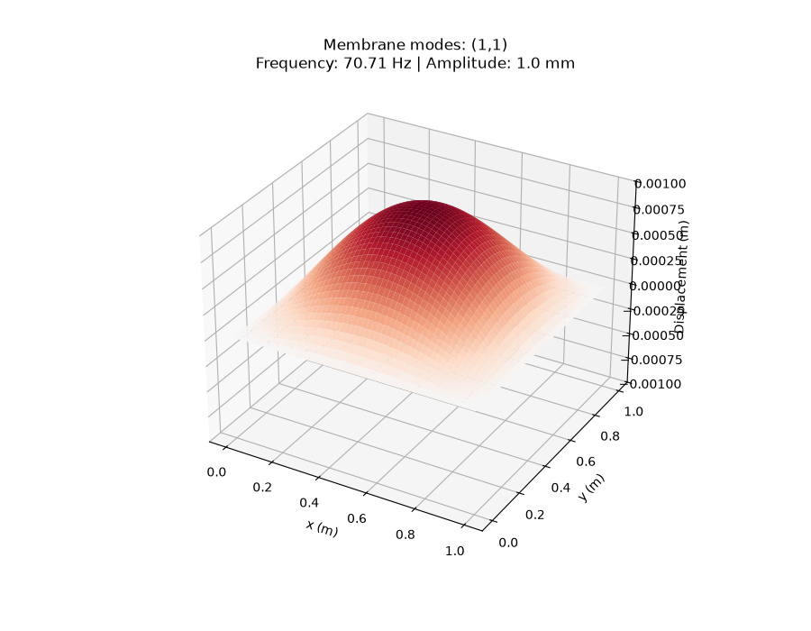
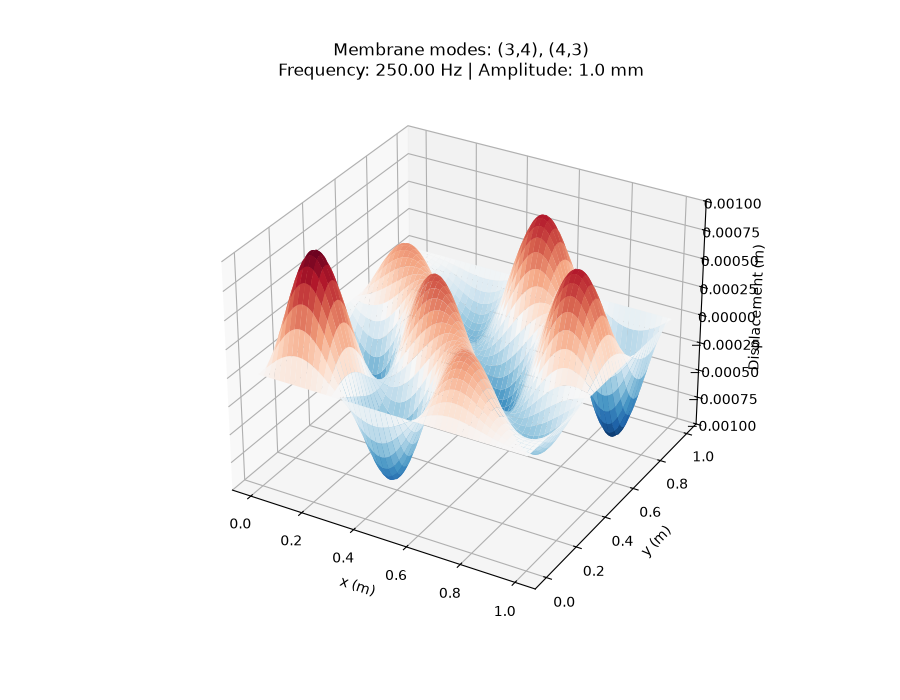
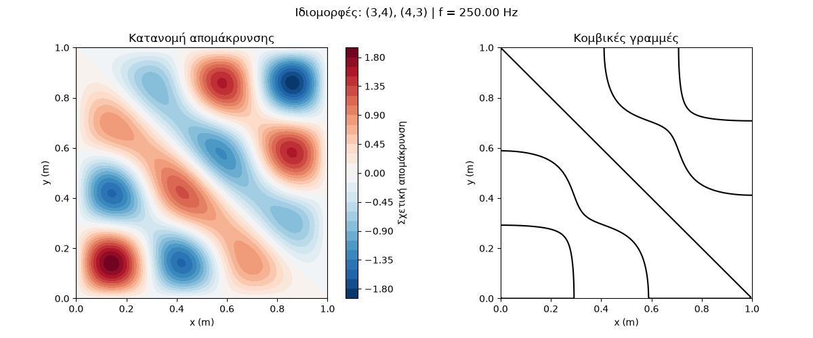

# Membrane Modes Simulation

A Python project for computing and visualizing the **normal modes of an ideal rectangular membrane with fixed edges**. Given a target frequency, the program searches a finite set of membrane eigenfrequencies, identifies the closest one, and displays its corresponding mode shape or an equal-weight superposition of degenerate modes.

The project combines an analytical wave model with numerical checks and visualizations using NumPy and Matplotlib.

## Features

- Compute analytical eigenfrequencies for mode indices `n, m = 1, ..., 5`.
- Find the eigenfrequency closest to a user-entered positive frequency.
- Identify all modes in the search set sharing that eigenfrequency (within a numerical tolerance).
- Visualize the spatial displacement pattern and nodal lines in 2D.
- Display a 3D snapshot of membrane displacement.
- Animate one oscillation period in slow motion.
- Optionally run checks of eigenfrequencies, fixed-edge boundary conditions, the dispersion relation, and the wave equation using finite differences.

## Physical model

Consider a uniform rectangular membrane with dimensions $L_x$ and $L_y$, under uniform tension, with all four edges fixed. Its transverse displacement $w(x,y,t)$ satisfies the two-dimensional wave equation:

$$
\frac{\partial^2 w}{\partial t^2}
= c^2\left(\frac{\partial^2 w}{\partial x^2}
+\frac{\partial^2 w}{\partial y^2}\right),
$$

where $c$ is the transverse wave speed. For an ideal membrane,

$$
c = \sqrt{\frac{\mathcal{T}}{\sigma}},
$$

with membrane tension per unit length $\mathcal{T}$ (N/m) and mass per unit area $\sigma$ (kg/m²).

### Boundary conditions

All edges remain at zero displacement:

$$
w(0,y,t)=w(L_x,y,t)=w(x,0,t)=w(x,L_y,t)=0.
$$

### Normal modes

The spatial part of a normal mode is

$$
\phi_{nm}(x,y)=
\sin\left(\frac{n\pi x}{L_x}\right)
\sin\left(\frac{m\pi y}{L_y}\right),
\qquad n,m=1,2,3,\ldots
$$

and the corresponding eigenfrequency is

$$
f_{nm}=\frac{c}{2}
\sqrt{\left(\frac{n}{L_x}\right)^2+
      \left(\frac{m}{L_y}\right)^2}.
$$

A single mode evolves as $w_{nm}(x,y,t)=A\,\phi_{nm}(x,y)\cos(2\pi f_{nm}t)$, for the chosen zero initial phase.

### Degenerate modes and superposition

Different mode-index pairs may have the same eigenfrequency. For a square membrane, for example, $(3,4)$ and $(4,3)$ both have a frequency of **250 Hz** when $L_x=L_y=1$ m and $c=100$ m/s.

When the program finds such modes, it adds their spatial patterns with **equal weights** and normalizes the resulting shape. This is a visualization convention: a real membrane's mixture of modes depends on how it is excited and on its initial conditions. The program does not solve a forced-response problem.

The normalized superposition is multiplied by a reference amplitude $A_0=0.001$ m (1 mm). This is an illustrative displacement scale, **not a prediction of the membrane's actual amplitude**.

## Default configuration

| Parameter | Default |
| --- | --- |
| Membrane width, $L_x$ | 1 m |
| Membrane height, $L_y$ | 1 m |
| Wave speed, $c$ | 100 m/s |
| Spatial grid | 200 × 200 points |
| Mode search range | $1\le n,m\le 5$ |
| Reference amplitude, $A_0$ | 1 mm |
| Animation frames | 40 per period |
| Animation interval | 50 ms per frame (slow-motion display) |

These values are defined in the Python source. The animation's playback speed is deliberately slower than the physical vibration frequency.

## Requirements

- Python 3
- [NumPy](https://numpy.org/)
- [Matplotlib](https://matplotlib.org/)

Install the dependencies in a terminal:

```bash
python -m pip install numpy matplotlib
```

## Running the program

Save the script as `membrane_modes.py`, then run:

```bash
python membrane_modes.py
```

Alternatively, open the file in **Python IDLE** and select **Run → Run Module (F5)**.

When prompted, enter a positive frequency in hertz, for example:

```text
Δώσε μια συχνότητα σε Hz: 240
```

The program finds the **closest available eigenfrequency** within the configured mode range. For the default square membrane, an input of 240 Hz selects 250 Hz, with modes `(3,4)` and `(4,3)`; the difference is 10 Hz.

**Important:** The input frequency is a search target, not an imposed driving frequency. The plotted and animated membrane oscillates at the selected *eigenfrequency*, not necessarily at the number entered by the user. Frequencies outside the search range are not modeled by adding higher modes automatically.

## Visualizations

**2D displacement map:** A filled contour plot of the relative spatial displacement pattern.

**Nodal-line plot:** Contours where the combined spatial displacement equals zero. Fixed boundaries are also nodes.

**3D snapshot:** A surface plot of displacement in meters, using a fixed vertical range and color scale based on the reference amplitude.

**3D animation:** A time-dependent view of the same normalized pattern, animated over one oscillation period. The animation is a slow-motion visualization rather than real-time physical playback.

> Suggested addition before publishing: save representative screenshots in an `images/` folder and link them here.

## Validation and numerical checks

The source includes an optional `run_tests()` routine. Set `RUN_TESTS = True` to execute it, or `False` for normal use. The checks cover:

1. **Analytical eigenfrequencies:** Comparison against the closed-form formula for selected mode pairs.
2. **Fixed-edge conditions:** Verification that the displacement is approximately zero at the four boundaries, within floating-point precision.
3. **Dispersion relation:** Verification that $\omega_{nm}^2=c^2[(n\pi/L_x)^2+(m\pi/L_y)^2]$.
4. **Numerical wave-equation residual:** Approximation of the spatial Laplacian using centered second-order finite differences and comparison with $-\omega_{nm}^2\phi_{nm}$.

For the 200 × 200 grid and test mode `(3,4)`, an earlier run produced a relative finite-difference residual of approximately **0.028%**. This is a discretization check, not a general error bound for every mode or grid size.

## Limitations

- The model describes an **ideal stretched membrane**, not a bending-stiffness-dominated vibrating plate. Although some nodal patterns resemble Chladni figures, plate vibration obeys a different governing equation.
- The program searches only mode indices from 1 to 5 in each direction.
- It uses a single chosen spatial superposition for degenerate modes, not excitation-dependent mode coefficients.
- It does not include damping, external forcing, material nonuniformity, or membrane nonlinearities.
- The displacement amplitude is chosen for illustration.

## Project structure

```text
membrane-modes/
├── membrane_modes.py    # Simulation, plots, animation, and checks
└── README.md            # Project documentation
```

## Possible future improvements

- Make membrane dimensions, wave speed, and search limits configurable at runtime.
- Allow the user to specify individual mode weights and phases.
- Add optional export of plots and animations.
- Separate automated numerical tests from the interactive simulation.

## Educational purpose

This project demonstrates how analytical solutions of the two-dimensional wave equation can be explored computationally. It is intended as a learning and visualization tool for wave physics, normal modes, numerical differentiation, and scientific programming with Python.
## Simulation Results

The following figures illustrate the normal modes and
vibration patterns of an ideal square membrane.

### Fundamental Mode (1,1)

The fundamental mode corresponds to the lowest natural
frequency of the membrane, approximately 70.71 Hz.



### Degenerate Modes (3,4) and (4,3)

For a square membrane, the modes (3,4) and (4,3)
have the same natural frequency of 250 Hz.

The simulation illustrates an equal-weight,
in-phase superposition of these two modes.

#### 3D Visualization



#### 2D Visualization and Nodal Lines

